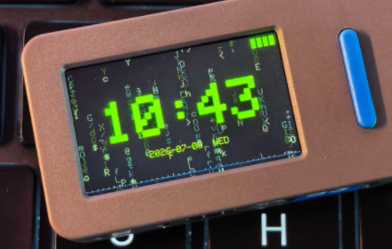

# CYBER CLOCK — M5StickS3 / M5Cardputer 赛博朋克桌面时钟

**中文** · [English](README.md)

**一块 240×135 横屏时钟，两台 M5 掌机：NTP 自动对时、列轨迹数字雨引擎、6 套霓虹配色、麦克风实时频谱——以及能把 StickS3 压进关背光 Light Sleep 的三段式省电。**

> *放桌上是一条 HUD，拿手里是一块仪表。*



*M5StickS3 · Matrix Green 主题 · `FULL` 模式（v1.0.1 构建；v1.1.0 界面零变化）。*

两个固件版本都在本仓库：`src/` 是 **M5StickS3** 版（双按键），`cardputer/` 是 **M5Cardputer** 版（物理键盘，界面完全一致）。两者共用同一套代码——画面、数字雨引擎、主题、配网、时区选择都是同一份实现，只有输入层和最深的睡眠档不同。

同一套数字雨引擎在 M5Stack Tab5 上的移植是另一个独立项目：[matrix-rain-tab5](https://github.com/andjiang0083/matrix-rain-tab5)（ESP32-P4，1280×720 MIPI-DSI）。

---

## 两个版本

| | **M5StickS3**（`src/`） | **M5Cardputer**（`cardputer/`） |
|---|---|---|
| 板卡 | M5Stack StickS3 — ESP32-S3，8MB Flash，8MB Octal PSRAM | M5Stack Cardputer — ESP32-S3，8MB Flash，8MB Octal PSRAM |
| 屏幕 | 1.14″ 240×135 ST7789，SPI，横屏 | 1.14″ 240×135 ST7789，SPI，横屏 |
| 输入 | `BtnA`（左）/ `BtnB`（右），短按 + 长按 | 物理 QWERTY 键盘 |
| 麦克风 | ES8311 | 板载麦克风 |
| IMU | BMI270 — 摇一摇换主题 | BMI270 — 摇一摇换主题 |
| 亮度 | 7 档（1% → 100%） | 7 档（`+` / `-`） |
| 最深省电 | **Light Sleep + 关背光 + `BtnA` 硬件唤醒** | 80MHz + 1fps（无 Light Sleep，见[已知限制](#已知限制)） |
| 构建 | 仓库根目录 `pio run` | `cd cardputer && pio run` |
| 固件 | `cyber-clock-vX.Y.Z-merged.bin` | `cyber-clock-cardputer-vX.Y.Z-merged.bin` |

---

## 现状

以下都是 **v1.1.0** 两个版本的真实状态，不是规划项。

| 模块 | 状态 | 说明 |
|---|---|---|
| NTP 对时 | ✅ 可用 | `ntp.aliyun.com` / `ntp.tencent.com` / `pool.ntp.org`，20 次重试 × 250ms；同步失败则退化为开机计时 |
| 时区选择 | ⚠️ 固定偏移 | UTC−12 … UTC+12，存 NVS，对时后生效。**不含夏令时规则** |
| 数字雨 | ✅ 可用 | 55 颗雨滴、6 字符拖尾（头亮尾暗衰减）、33fps 上限 |
| 6 种字符集 | ✅ 可用 | `MATRIX` `NUMBERS` `BINARY` `HEX` `SYMBOLS` `ALPHA`，各带专属头部色调 |
| 6 套主题 | ✅ 可用 | 霓虹青 / 矩阵绿 / 极光紫 / 残烬橙 / 血红 / 暗夜红 |
| 三种界面 | ✅ 可用 | `FULL` / `TIME` / `SAVER`（纯雨） |
| 亮度调节 | ✅ 可用 | 7 档；StickS3 长按 `BtnB`，Cardputer 用 `+` / `-` |
| 麦克风频谱 | ✅ 可用 | 40 段彩条、逐段色相、峰值闪白、VU 衰减；麦克风启动失败则静默关闭 |
| IMU 摇一摇换主题 | ✅ 可用 | 互补滤波姿态角变化率，连续 3 次触发 |
| 电量显示 | ✅ 可用 | 右上角 4 格，I²C 读取缓存 1 秒 |
| WiFi 配网 | ✅ 可用 | 扫描 → 列表 → 输密码 → 连接 → 存 NVS；StickS3 用双按键驱动的屏幕键盘 |
| 闲置省电 | ✅ 可用 | 60s → 80MHz + 1fps；仅 StickS3：180s → Light Sleep |
| USB 充电免省电 | ✅ 可用 | 插 USB 即关闭全部省电档，全速运行 |
| 中文/非 ASCII SSID | ⚠️ 已知 | 显示成 `□` 方框——字体和屏幕键盘都只支持 ASCII |
| Cardputer Light Sleep | ❌ 做不到 | 键盘挂在 TCA8418 I²C 扩展芯片上，没有唤醒线 |
| OTA 升级 | ❌ 未实现 | 目前通过 USB-C 刷机 |
| 天气 / 自动亮度 / 闹钟 | ❌ 未实现 | 见 [ROADMAP_CN.md](ROADMAP_CN.md) |

### 已知限制

1. **Cardputer 无法 Light Sleep。** 它的按键走 I²C 扫描，没有能唤醒 CPU 的 GPIO。80MHz + 1fps 就是它的下限。StickS3 能到 ~0.3mA，是因为 `BtnA` 接在 GPIO0 上，可以作为 `ext0` 唤醒源。
2. **时区是偏移量，不是规则。** 选 `UTC+8` 就是永远 UTC+8，不会自动切夏令时。
3. **只支持 ASCII。** GLCD 字体和屏幕键盘都止于 ASCII，所以中文 SSID 显示为 `□`。

---

## 快速开始

### 方式一：刷发布镜像（不需要工具链）

1. 从 [Releases](../../releases) 下载 `cyber-clock-v1.1.0-merged.bin`（StickS3）或 `cyber-clock-cardputer-v1.1.0-merged.bin`（Cardputer）。
2. **M5Burner**：*Custom* → *Import Custom FW* → 选 `.bin`（或 `m5burner/` 里的打包文件）→ 选中 **Cyber Clock** → *Burn*。
3. **esptool** 命令行方式：

   ```bash
   esptool.py --chip esp32s3 --baud 921600 write_flash 0x0 cyber-clock-v1.1.0-merged.bin
   ```

   合并镜像内含 bootloader + 分区表 + 应用，从偏移 `0x0` 写入。下载后用 release notes 里的 `sha256` 校验。

### 方式二：从源码构建

```bash
git clone https://github.com/andjiang0083/cyber-clock.git
cd cyber-clock
pio run                              # StickS3
pio run --target upload --upload-port /dev/cu.usbmodemXXXX

cd cardputer
pio run                              # Cardputer
pio run --target upload --upload-port /dev/cu.usbmodemXXXX
```

完整步骤、工具链版本、以及我们踩过的每一个坑，都写在 [BUILDING_CN.md](BUILDING_CN.md)（[English](BUILDING.md)）。

### 首次开机

1. 开机动画跑 3 秒（背景是实时数字雨），任意输入可跳过。
2. **没有保存过 WiFi** → 自动进入配网向导：扫描、选网、输密码，然后选时区。凭据和时区偏移都写进 NVS。
3. **保存过 WiFi** → 连接 → NTP 对时 → **随即关闭射频**，此后时钟不再需要网络。
4. 时区选择器只在没有存过偏移量时出现。之后想重新配网：StickS3 在开机动画期间按住 `BtnA`；Cardputer 任意时刻按 `W`。

> **没有网络就没有钟。** 首次开机需要一个 2.4GHz 热点。之后靠 ESP32 内部 RTC 走时；如果从未对时成功，屏幕显示的是开机以来的计时。

---

## 操作

### M5StickS3

| 操作 | `BtnA`（左） | `BtnB`（右） |
|---|---|---|
| **短按** | 界面循环：`FULL → TIME → SAVER` | `FULL`/`TIME` 下切主题 · `SAVER` 下切字符集 |
| **长按**（≈0.5s） | 切换数字雨字符集 | 亮度循环（7 档） |
| **摇一摇** | — | 随机换主题 |

两键映射是刻意做成闭环的：日常操作走短按，设置类走长按。

### M5Cardputer

| 按键 | 功能 |
|---|---|
| `S` | 界面循环：`FULL → TIME → SAVER` |
| `R` | 切换数字雨字符集 |
| `C` | `FULL`/`TIME` 下切主题 · `SAVER` 下切字符集 |
| `W` | 连接 WiFi 并重新对时（扫描 → 选网 → 密码 → 对时） |
| `+` / `-` | 亮度加 / 减（7 档） |
| 摇一摇 | 随机换主题 |

键盘配网：`;` / `.` 上下翻列表，`Enter` 确认，`Del` 删字符，`Esc` 取消。字母键做了边沿检测，按住不会重复触发。

---

## 界面模式、数字雨与主题

| 模式 | 数字雨 | 时钟 | 日期 | 电量 | 频谱 |
|---|---|---|---|---|---|
| **FULL** | ✅ | ✅ | ✅ | ✅ | ✅ |
| **TIME** | ✅ | ✅ | — | ✅ | — |
| **SAVER** | ✅ | — | — | — | — |

| 字符集 | 字符池 | 头部色调 |
|---|---|---|
| `MATRIX` | `01#*+:.A-Za-z<>/\|~@%&$` | 蓝绿 |
| `NUMBERS` | `0-9` | 纯绿 |
| `BINARY` | `01` | 青 |
| `HEX` | `0-9A-F` | 蓝紫 |
| `SYMBOLS` | `#*+:.<>/\|~@%&$` | 暖红 |
| `ALPHA` | `A-Z` | 淡蓝 |

| 编号 | 主题 | 主色 | 点缀色 | 风格 |
|---|---|---|---|---|
| 1 | **Neon Cyan** | `#00FFFF` | `#FF00FF` | 经典赛博朋克 |
| 2 | **Matrix Green** | `#00FF41` | `#004400` | 黑客帝国 |
| 3 | **Aurora Purple** | `#8844FF` | `#00DDFF` | 合成波复古 |
| 4 | **Ember Orange** | `#FF6600` | `#FF2200` | 烈火街头 |
| 5 | **Blood Red** | `#FF0044` | `#FFAA00` | 银翼杀手 |
| 6 | **Night Red** | `#340000` | `#4C0000` | 夜间舒适 |

亮度档位：1% · 5% · 10% · 30% · 50% · 80% · 100%（默认 30%）。亮度**不做持久化**——重启回到 30%，这是故意的：没人想在白天到处找一个只有 1% 亮度的屏幕。

---

## 省电机制

三段，插着 USB 时全部关闭（充电 ⇒ 全速，绿色 LED 恢复）：

| 阶段 | 触发 | CPU | 刷新 | 麦克风 | 背光 |
|---|---|---|---|---|---|
| 正常 | — | 240MHz | ~33fps | 开 | 开 |
| 降频 | 60s 无操作 | 80MHz | 1fps（秒数变化时才画） | 关 | 开 |
| **Light Sleep**（仅 StickS3） | 180s 无操作 | 暂停 | 200ms 轮询唤醒后每秒一帧 | 关 | **关** |

任意输入 ≤200ms 恢复全速。Light Sleep 期间由 RTC 定时器每 200ms 唤醒 CPU 轮询按键，同时 `BtnA`（GPIO0）额外配置为 `ext0` 唤醒源，所以按下即时响应。Cardputer 没有最深那一档，原因见上文。

[ARCHITECTURE_CN.md](docs/ARCHITECTURE_CN.md) 里的电流数字是 ESP32-S3 数据手册的设计目标值，**不是电流表实测**——如果你有功耗仪，[ROADMAP_CN.md](ROADMAP_CN.md) 里正好缺这一项。

---

## 工作原理

```
setup()
 ├─ M5.begin() + ArcDisplay::begin(rotation 1)   → 240×135 横屏，Sprite 双缓冲
 ├─ initThemes() / initMatrixRain()              → 6 套配色、55 颗雨滴
 ├─ 3 秒开机动画（实时数字雨背景）                → 任意输入跳过
 ├─ tzLoad() 从 NVS 读时区                       → 对时后生效
 ├─ wifiSetupBegin()                             → 只在没有可用凭据时才走
 │   └─ pickTimezone()                           → 按键（StickS3）或 `;` `.` `N`（Cardputer）
 └─ initAudio()                                  → 麦克风起不来就静默关闭

loop()   [~33fps；闲置 1fps]
 ├─ 是否充电？          → 取消所有省电档，恢复全速
 ├─ 闲置状态机          → 60s ⇒ 80MHz，180s ⇒ Light Sleep（StickS3）
 ├─ 输入                → arcGetKey()（按键）/ getKey()（键盘，边沿检测）
 ├─ updateTime()        → epoch + 已过毫秒，不每秒调 NTP
 ├─ updateIMU() / checkShake()
 ├─ updateAudio()       → 160 采样一块，算出 40 段频谱
 ├─ render(mode)        → 清屏 → 数字雨 → 时钟 → 日期 → 电量 → 频谱
 ├─ ArcDisplay::push()  → 原子化推屏
 └─ [Light Sleep] esp_light_sleep_start() + 定时器 / ext0 唤醒
```

值得细看的部分——列轨迹衰减的算法、修掉黑屏的 Sprite 分配兜底、Cardputer 为什么睡不下去、从 Launcher 移植的 WiFi 层——都写在 [docs/ARCHITECTURE_CN.md](docs/ARCHITECTURE_CN.md)（[English](docs/ARCHITECTURE.md)）。

---

## 性能

干净构建实测（全新 clone 后 `pio run`；PlatformIO Core 6.1.19、espressif32 平台 7.0.1、Arduino 核心 3.3.9、M5Unified 0.2.23 / M5GFX 0.2.30）：

| 平台 | RAM | Flash | 帧率 |
|---|---|---|---|
| M5StickS3 | 52,872 B / 327,680 B（16.1%） | 1,176,559 B / 3,342,336 B（35.2%） | 正常 ~33fps，闲置 1fps |
| M5Cardputer | 53,480 B / 327,680 B（16.3%） | 1,176,451 B / 3,342,336 B（35.2%） | 正常 ~33fps，闲置 1fps |

33fps 的上限来自 `delay(30)`——数字雨不需要更快，剩下的 CPU 余量正是 Light Sleep 那一档能成立的前提。屏幕上**刻意没有帧率显示**：这个项目的规矩是，显示区只放属于一块钟的信息。

---

## 目录结构

```
cyber-clock/
├── platformio.ini              StickS3 构建配置
├── src/                        StickS3 应用
│   ├── main.cpp                数字雨引擎、时钟、UI、省电状态机
│   ├── config.h                所有可调常量（版本、时序、亮度、数字雨）
│   ├── wifisetup.cpp/.h        扫描 → 选网 → 密码 → 连接 → NVS
│   ├── textinput.cpp/.h        双按键 StickS3 的屏幕键盘
│   ├── timesync.h              共享 NTP 声明
│   └── idf/idf_wifi.cpp/.h     ESP-IDF 原生 WiFi（扫描 / AP / 连接 / 密码错误检测）
├── cardputer/                  Cardputer 应用（同一套 UI，键盘输入）
│   ├── platformio.ini
│   └── src/
├── arcadia/core/               作者自用 GUI 框架的内嵌快照
├── docs/ARCHITECTURE_CN.md     设计说明与分模块细节
├── m5burner/                   M5Burner 目录条目
├── tools/make-release.sh       合并镜像生成脚本
└── .github/                    issue 表单、PR 模板
```

### 关于 `arcadia/`

`arcadia/core/` 是 *Arcadia* 的**内嵌快照**——作者在多个 ESP32 项目里复用的一套 header-only GUI / 输入 / IMU / 省电框架。固件通过 `#include <core/arcadia.h>` 使用它，随仓库一起提交是为了让 `git clone && pio run` 一步就能编（包含路径在 `platformio.ini` 里：`-I${PROJECT_DIR}/arcadia`）。请把它当副本看待，而不是上游源。

---

## 参与共建

欢迎开 issue 和 PR。项目特有的约定（来自真实故障，不是口味问题）见 [CONTRIBUTING_CN.md](CONTRIBUTING_CN.md)（[English](CONTRIBUTING.md)）；可上手的具体事项见 [ROADMAP_CN.md](ROADMAP_CN.md)（[English](ROADMAP.md)）。

报 bug 时最能省时间的两条信息：**是哪个版本（StickS3 还是 Cardputer）**，以及**屏幕是自己恢复的还是必须断电**——这一条能把软件 panic 和硬件级死锁分开，两者根因完全不同。

## 致谢与许可

建立在 M5Stack 的 M5Unified/M5GFX、乐鑫的 Arduino 核心与 ESP-IDF，以及一套从 [bmorcelli/Launcher](https://github.com/bmorcelli/Launcher)（MIT）起步的 WiFi 配网层之上。完整署名——包括哪些文件来自 Launcher——见 [CREDITS.md](CREDITS.md)。

**MIT** 许可，见 [LICENSE](LICENSE)。M5Stack、StickS3、Cardputer、ESP32 是各自所有者的商标，本项目与 M5Stack 无隶属关系，只是拥有硬件的社区用户写的应用。赛博朋克配色均为原创调色，不含任何影视素材、第三方美术资源或专有字体。
